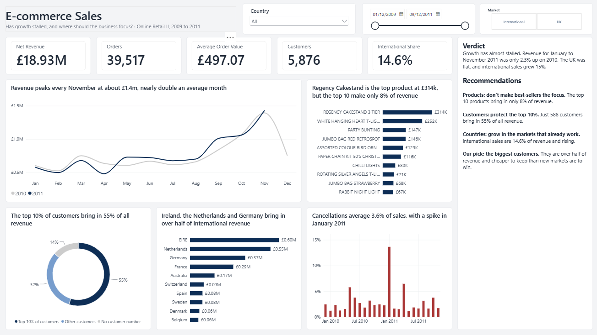

# E-commerce Sales Analysis

**Has growth stalled, and where should the business focus?** Two years of sales from a UK online gift retailer, cleaned in PostgreSQL and analysed in a one-page Power BI dashboard.

**Tools:** Excel · PostgreSQL · Power BI (DAX)

## Demo

<!-- In the GitHub editor, drag images/slicer_demo.mp4 onto the line below to embed the video -->

A 30-second walkthrough of the slicers filtering the page. [Download the video](images/slicer_demo.mp4)

## The problem

A UK online gift retailer sells mostly to wholesale customers. Growth seems to be slowing, and the business needs to decide where to focus next: its best-selling products, its biggest customers, or its international markets.

## The data

[Online Retail II](https://archive.ics.uci.edu/dataset/502/online+retail+ii) from the UCI Machine Learning Repository: 1,067,371 rows of transactions from December 2009 to December 2011, one row per product per order. The data is not stored here; see [data/README.md](data/README.md) for the download.

## What I did

1. **Checked the raw data in Excel:** row counts, cancellations, blanks and date ranges ([Excel checks](docs/excel_checks.md)).
2. **Loaded both years into PostgreSQL and cleaned them:** removed non-product codes, zero prices and exact duplicates, and flagged cancellations. Every decision is in the [cleaning log](docs/cleaning_log.md).
3. **Answered 11 business questions in SQL**, using window functions (`LAG`, `NTILE`) for year-on-year growth and customer ranking ([queries](sql/04_business_questions.sql)).
4. **Built a one-page Power BI dashboard** with DAX measures ([measures](docs/dax_measures.md)), checked against the SQL totals.

## What I found

- **Growth has almost stalled.** Revenue for January to November 2011 was only 2.3% up on 2010. The UK was flat; international sales grew 15%.
- **November is the peak.** Revenue reaches about £1.4m every November, nearly double an average month.
- **Best-sellers matter less than they look.** Regency Cakestand is the top product at £314k, but the top 10 products make only 8% of revenue.
- **A few customers carry the business.** The top 10% of customers, 588 accounts, bring in 55% of all revenue. Over a quarter of customers (27.6%) bought only once.
- **International is small but growing.** It is 14.6% of revenue; Ireland, the Netherlands and Germany bring in over half of it.
- **Cancellations** average 3.6% of sales, with a spike in January 2011.

## Recommendation

| Area | Recommendation | Evidence |
| --- | --- | --- |
| Products | Don't make best-sellers the focus | The top 10 bring in only 8% of revenue |
| Customers | Protect the top 10% | 588 customers bring in 55% of revenue |
| Countries | Grow in the markets that already work | International is 14.6% of revenue and rising |

**Pick: the biggest customers.** They are over half of revenue and cheaper to keep than new markets are to win.

## Limits

- Removing exact duplicates is a judgement call: a few may be the same item scanned twice on one order.
- 243,007 rows have no customer number, so the customer findings cover known customers only.
- December 2011 stops on the 9th, so it is left out of monthly comparisons.
- Orders differ by one between PostgreSQL (39,516) and Power BI (39,517). I traced a related problem to invoice numbers that Excel had turned into dates and fixed it; one order of difference remains unexplained.

## How to reproduce

1. Download the data and save each sheet as a CSV ([data/README.md](data/README.md)).
2. Run the files in [sql](sql) in number order in PostgreSQL. Each file has the expected result as a comment under every check.
3. Open [powerbi/ecommerce_dashboard.pbix](powerbi/ecommerce_dashboard.pbix) in Power BI Desktop. The data is saved inside the file.

## Files

| Folder | What is in it |
| --- | --- |
| [sql](sql) | Five SQL files, run in number order |
| [powerbi](powerbi) | The dashboard (.pbix and PDF) and the theme file |
| [docs](docs) | Cleaning log, data dictionary, Excel checks, DAX measures |
| [images](images) | Dashboard screenshot and slicer demo |
| [data](data) | Where to download the data |

Data: Chen, D. (2019). Online Retail II. UCI Machine Learning Repository. Licensed CC BY 4.0.
